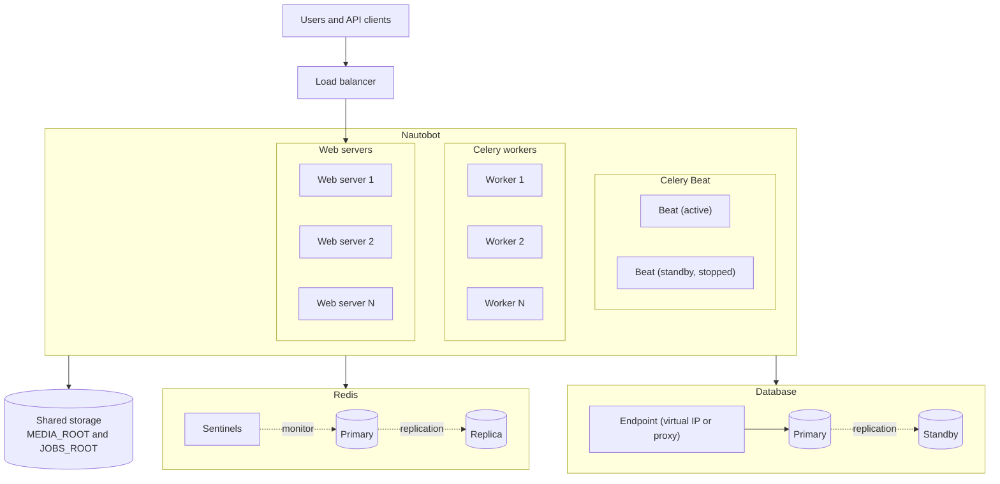

# High Availability

This guide describes how to deploy Nautobot so that the failure of a single server or process does not take the whole service down. It covers what Nautobot needs from each component of the deployment. Setting up high availability for the database or Redis themselves is outside the scope of this guide, so refer to the documentation of those projects, or of your managed service provider, for the details.

!!! note
    If you deploy Nautobot on Kubernetes, see the [Nautobot Helm Charts documentation](https://docs.nautobot.com/projects/helm-charts/en/stable/).

## Architecture Overview

A Nautobot deployment is made up of the following components:

- **Web servers**, which serve the web UI and the REST API.
- **Celery workers**, which run Jobs and other background tasks.
- **Celery Beat**, the scheduler that starts scheduled Jobs.
- **A database** (PostgreSQL or MySQL), which holds all Nautobot data.
- **Redis**, which Nautobot uses for caching and as the Celery message broker.

Web servers and Celery workers can be scaled out to as many instances as you need, and the loss of any one of them is absorbed by the others. Celery Beat must run as a single instance. The database and Redis are made highly available with their own tooling, and Nautobot connects to them through a single, stable endpoint.

## Web Servers

Run two or more web servers behind a load balancer, and configure the load balancer to send health checks to the `/health/` endpoint of each web server, so that a server that stops responding with HTTP `200 OK` is taken out of rotation. See [Health Checks](health-checks.md#nautobot-http-server) for what this endpoint verifies.

By default, Nautobot stores user sessions in the database, so any web server can handle any request and the load balancer does not need sticky sessions. If you configure file-based sessions with [`SESSION_FILE_PATH`](../configuration/settings.md#session_file_path), that path must be shared between all web servers.

If you run uWSGI behind a load balancer, set the uWSGI timeouts relative to the load balancer timeouts as described in [Deploying Nautobot Services](../installation/services.md#configuration).

All web servers, Celery workers, and the Celery Beat scheduler must run the same Nautobot version with the same apps installed, and share the same `nautobot_config.py`. In particular:

- [`SECRET_KEY`](../configuration/settings.md#secret_key) must be identical on all nodes. Otherwise sessions and other signed values created on one node are rejected by the others.
- [`ALLOWED_HOSTS`](../configuration/settings.md#allowed_hosts) must include the hostname that clients use to reach the load balancer.

## Celery Workers

You can run as many Celery workers as you need, on as many hosts as you need. All workers consume tasks from the same Redis message broker, so if a worker fails, the remaining workers keep processing the queue. See [Task Queues](celery-queues.md) for guidance on dedicating workers to specific queues and on how tasks are acknowledged when a worker fails while processing them.

## Celery Beat

!!! warning
    Run exactly one Celery Beat instance across the whole deployment. Every running instance starts each scheduled Job, so two instances run every scheduled Job twice.

To survive the loss of the host that runs Celery Beat, use an active/passive arrangement in which a standby instance is only started once the active instance is confirmed to be down. On virtual machines, a cluster resource manager such as Pacemaker can do this. On Kubernetes, a Deployment with a single replica replaces a failed pod automatically. You can detect a failed scheduler with the heartbeat file described in [Health Checks](health-checks.md#nautobot-celery-beat).

While no Celery Beat instance is running, scheduled Jobs are not started.

## Database

Nautobot connects to a single database endpoint, configured in [`DATABASES`](../configuration/settings.md#databases). To make the database highly available, use the replication and failover tooling of your database, for example [Patroni](https://patroni.readthedocs.io/) for PostgreSQL or [InnoDB Cluster](https://dev.mysql.com/doc/mysql-shell/en/mysql-innodb-cluster.html) for MySQL, and point Nautobot at an endpoint that always leads to the current primary, such as a virtual IP or a proxy. Managed database services from cloud providers usually provide such an endpoint out of the box.

## Redis

All nodes must connect to the same Redis deployment. Besides caching and Celery task queueing, Nautobot uses Redis for locks that prevent concurrent REST API requests from allocating the same available IP address, prefix, or VLAN.

Nautobot supports [Redis Sentinel](https://redis.io/docs/latest/operate/oss_and_stack/management/sentinel/) for high availability. Redis Cluster is not supported. See [High Availability Using Redis Sentinel](../configuration/redis.md#high-availability-using-redis-sentinel) for the required configuration.

## Files Shared Between Nodes

Several Nautobot settings point to paths on the local filesystem. In a deployment with more than one node, handle them as follows:

| Setting | Contents | Requirement |
| ------- | -------- | ----------- |
| [`MEDIA_ROOT`](../configuration/settings.md#media_root) | Uploaded files, such as image attachments | Share between all web servers and Celery workers, with a shared volume or with an object storage backend configured in [`STORAGES`](../configuration/settings.md#storages). See [Django Storages with S3](s3-django-storage.md) for an example. |
| [`JOBS_ROOT`](../configuration/settings.md#jobs_root) | Jobs installed as Python files | Keep identical on all web servers and Celery workers, for example with a shared volume. |
| [`STATIC_ROOT`](../configuration/settings.md#static_root) | CSS, JavaScript, and other static assets | Run `nautobot-server collectstatic` on each web server, or serve the files from shared storage. |
| [`GIT_ROOT`](../configuration/settings.md#git_root) | Local clones of [Git repositories](../../platform-functionality/gitrepository.md) | No sharing needed. Each node keeps its own clone and checks out the commit recorded in the database. Every node needs network access to the Git remotes. |
| [`STORAGES["nautobotjobfiles"]`](../configuration/settings.md#storages) | Files uploaded as Job inputs and files generated by Jobs | Stored in the database by default, which works across nodes but is a fallback option. Prefer an object storage backend from [`django-storages`](https://django-storages.readthedocs.io/en/stable/), such as S3. See [Django Storages with S3](s3-django-storage.md) for an example. |
