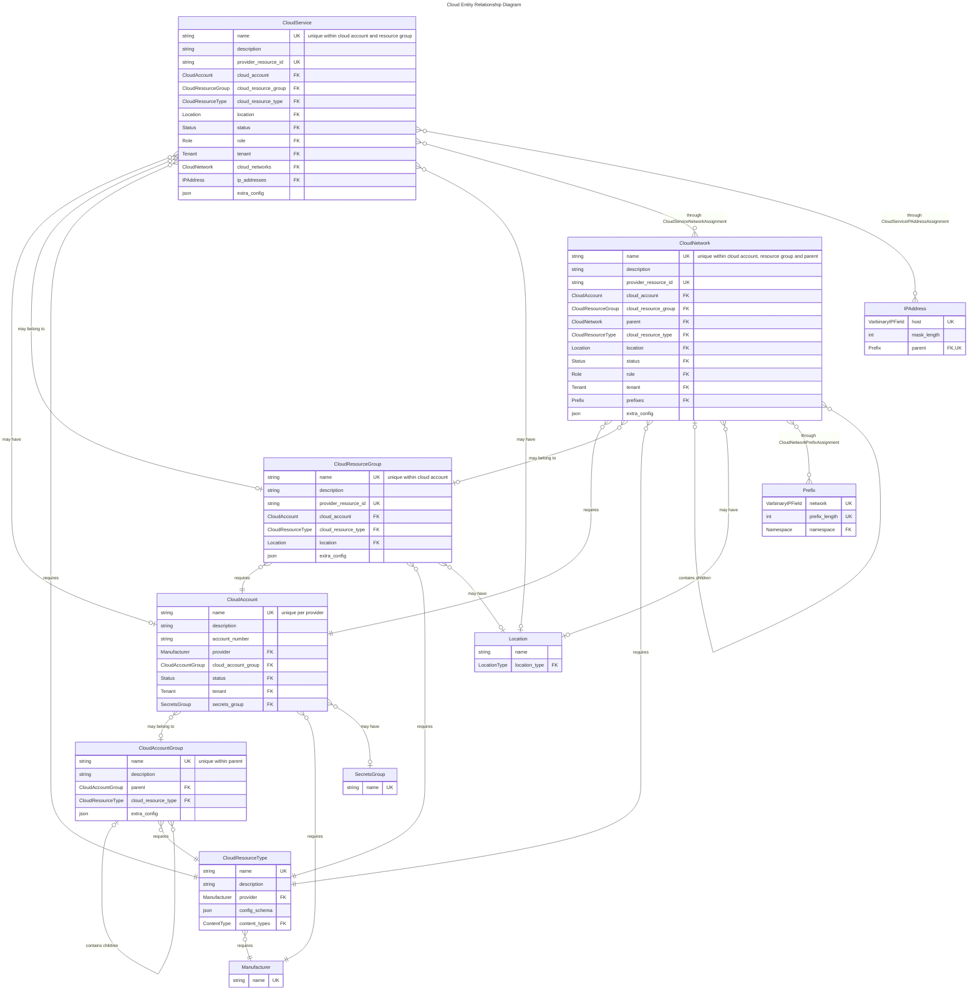

# Cloud

The Cloud data models allow the modeling of public and private cloud environments in Nautobot, from the organization of cloud accounts down to the [cloud networks](./cloudnetwork.md) and [cloud services](./cloudservice.md) deployed in them. The models fit together as follows:

- A [cloud account](./cloudaccount.md) represents an account with a cloud provider, such as an AWS account, an Azure subscription or a GCP project. The provider itself is represented by a [manufacturer](../dcim/manufacturer.md).
- [Cloud account groups](./cloudaccountgroup.md) form a tree of organization containers above cloud accounts, such as Azure management groups, AWS organizational units or GCP folders.
- [Cloud resource groups](./cloudresourcegroup.md) are containers of resources inside a single cloud account, such as Azure resource groups.
- [Cloud networks](./cloudnetwork.md) represent virtual networks, such as AWS VPCs or Azure virtual networks, and their subnets. [Prefixes](../ipam/prefix.md) can be assigned to them.
- [Cloud services](./cloudservice.md) represent the services deployed in cloud accounts, such as load balancers, VPN gateways or private endpoints. They can be attached to cloud networks and can have [IP addresses](../ipam/ipaddress.md) assigned to them.
- [Cloud resource types](./cloudresourcetype.md) describe the kind of each cloud account group, cloud resource group, cloud network and cloud service, and can define a schema for its extra configuration.

Cloud resource groups, cloud networks and cloud services can record the identifier assigned to them by the provider in their `provider_resource_id` field, such as an Azure resource ID, an AWS ARN or a GCP resource name. They can also be assigned to a [location](../dcim/location.md), such as the cloud region they are deployed in.

Cloud accounts, cloud networks and cloud services have an operational [status](../../platform-functionality/status.md) and can be assigned to a [tenant](../tenancy/tenant.md). Cloud networks and cloud services can also be assigned a [role](../../platform-functionality/role.md).

Cloud services can be referenced from other areas of Nautobot. A [virtual server](../load-balancers/virtualserver.md) can be attached to a cloud service that represents a cloud load balancer, and a [VPN tunnel endpoint](../vpn/vpntunnelendpoint.md) can be attached to a cloud service that represents a cloud VPN gateway.

+++ 3.3.0
    The cloud account group, cloud resource group and cloud service IP address assignment models have been added, together with provider resource IDs, locations, statuses, roles and tenants on the existing cloud models.

## Examples

### AWS Direct Connect

Here is an example of how these models can be used together to model an AWS Direct Connect.


```yaml
# Pseudocode
manufacturers:
  - name: "Amazon"

cloud_accounts:
  - name: "AWS"
    account_number: "A-123456"
    provider: "Amazon"
    status: "Active"

cloud_resource_type:
  - name: "VPC"
    provider: "Amazon"
    content_types:
      - cloud.cloudnetwork

  - name: "S3"
    provider: "Amazon"
    content_types:
      - cloud.cloudservice

cloud_networks:
  - name: "VPC-01"
    cloud_resource_type: "VPC"
    cloud_account: "AWS"
    status: "Active"
    prefixes: [<prefix:10.1.0.0/16>]

cloud_services:
  - name: "S3 Bucket 3"
    cloud_resource_type: "S3"
    status: "Active"
    cloud_networks:
      - "VPC-01"

circuits:
  - name: "AWS Direct Connect 1"
    termination_a:
      site: "Customer Office"
    termination_z:
      cloud_network: "VPC-01"

```

### Azure Hub Network

Here is an example of how the cloud account groups, cloud resource groups, provider resource IDs, locations and IP addresses can be used to model a hub virtual network in Azure, with a private endpoint in one of its subnets.

```yaml
# Pseudocode
manufacturers:
  - name: "Microsoft"

cloud_resource_types:
  - name: "Azure Management Group"
    provider: "Microsoft"
    content_types:
      - cloud.cloudaccountgroup

  - name: "Azure Resource Group"
    provider: "Microsoft"
    content_types:
      - cloud.cloudresourcegroup

  - name: "Azure Virtual Network"
    provider: "Microsoft"
    content_types:
      - cloud.cloudnetwork

  - name: "Azure Subnet"
    provider: "Microsoft"
    content_types:
      - cloud.cloudnetwork

  - name: "Azure Private Endpoint"
    provider: "Microsoft"
    content_types:
      - cloud.cloudservice

location_types:
  - name: "Cloud Region"
    content_types:
      - cloud.cloudresourcegroup
      - cloud.cloudnetwork
      - cloud.cloudservice

locations:
  - name: "West Europe"
    location_type: "Cloud Region"
    status: "Active"

cloud_account_groups:
  - name: "root"
    cloud_resource_type: "Azure Management Group"

  - name: "prod-workloads"
    cloud_resource_type: "Azure Management Group"
    parent: "root"

cloud_accounts:
  - name: "sub-network-prod"
    account_number: "00000000-0000-0000-0000-000000000001"
    provider: "Microsoft"
    cloud_account_group: "prod-workloads"
    status: "Active"

cloud_resource_groups:
  - name: "rg-network-prod"
    cloud_resource_type: "Azure Resource Group"
    cloud_account: "sub-network-prod"
    provider_resource_id: "/subscriptions/00000000-0000-0000-0000-000000000001/resourceGroups/rg-network-prod"
    location: "West Europe"

cloud_networks:
  - name: "vnet-hub"
    cloud_resource_type: "Azure Virtual Network"
    cloud_account: "sub-network-prod"
    cloud_resource_group: "rg-network-prod"
    provider_resource_id: "/subscriptions/00000000-0000-0000-0000-000000000001/resourceGroups/rg-network-prod/providers/Microsoft.Network/virtualNetworks/vnet-hub"
    location: "West Europe"
    status: "Active"
    prefixes: [<prefix:10.10.0.0/16>]

  - name: "snet-private-endpoints"
    cloud_resource_type: "Azure Subnet"
    cloud_account: "sub-network-prod"
    cloud_resource_group: "rg-network-prod"
    parent: "vnet-hub"
    provider_resource_id: "/subscriptions/00000000-0000-0000-0000-000000000001/resourceGroups/rg-network-prod/providers/Microsoft.Network/virtualNetworks/vnet-hub/subnets/snet-private-endpoints"
    location: "West Europe"
    status: "Active"
    prefixes: [<prefix:10.10.1.0/24>]

cloud_services:
  - name: "pe-storage-prod"
    cloud_resource_type: "Azure Private Endpoint"
    cloud_account: "sub-network-prod"
    cloud_resource_group: "rg-network-prod"
    provider_resource_id: "/subscriptions/00000000-0000-0000-0000-000000000001/resourceGroups/rg-network-prod/providers/Microsoft.Network/privateEndpoints/pe-storage-prod"
    location: "West Europe"
    status: "Active"
    cloud_networks:
      - "snet-private-endpoints"
    ip_addresses: [<ip_address:10.10.1.4/24>]

```

## Entity Relationship Diagram

This schema illustrates the connections between related models. Status, role and tenant are shown as fields only, for readability.


